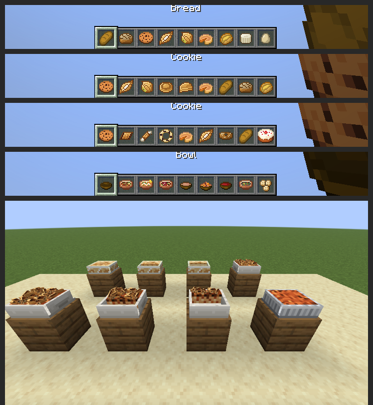

# Malta in Minecraft: content mod

An optional Fabric 26.3 add-on mod for the [Malta in Minecraft](https://maltaminecraft.com) world. It brings Maltese food, wildlife, crops and everyday life to the islands while you play. The world itself stays pure vanilla, so removing the mod leaves the islands as they were.



## Features

The mod is in its art phase. Everything below can be seen in the game, but has no recipes or food values yet.

- **Maltese food:** ħobż tal-Malti, ftira, ħobż biż-żejt, ftira Għawdxija, galletti, four kinds of pastizzi, ġbejna, imqaret, kannoli and qagħaq tal-għasel.
- **Stews and dips** in a Maltese terracotta bowl: stuffat tal-fenek, aljotta, stuffat tal-qarnit and bigilla.
- **Oven dishes you set on a table and eat in slices**, like a cake: ross il-forn, imqarrun il-forn, timpana and torta tal-lampuki.
- **A kitchen:** the kenur (a stone stove) and the borma (a clay stew pot).

The full list with item ids is in [docs/Food/Food in the mod.md](docs/Food/Food%20in%20the%20mod.md).

## Install

There's no release yet. To build the mod yourself, you need Java 25:

```
cd mod
./gradlew build
```

On Windows, run `gradlew.bat build` instead. The jar is in `mod/build/libs/`. Put it in your Fabric 26.3 `mods` folder with Fabric API.

## Use

Start a world with the mod and look for the items in the creative inventory. The design docs are an Obsidian vault: open the `docs/` folder in Obsidian and start at `Home.md`.

To see the art in the game, `tools/run-art.sh` builds the mod and takes screenshots on an invisible desktop (Linux, needs `env.sh`; see `env.sh.example`). Several can run at once: give each a name with `ART_RUN=<name> tools/run-art.sh`, and its screenshots go to `.art-runs/<name>/build/smoke-run/screenshots`. To watch the art being made in your browser, run `python3 tools/art-viewer.py` and open http://localhost:8765. It shows candidates, the picks, in-game shots, test runs and your decisions as they happen. The art itself is made by the scripts in `art/src/` (see [art/README.md](art/README.md)).

## Notes

- The mod's id is `mimcontent`, a working name. The final name isn't chosen yet.
- Changes are listed in [CHANGELOG.md](CHANGELOG.md).

## License

Private for now. A licence will be added before any public release.
