# Fish progress

Every fish and sea creature planned for the mod, with a picture of each as it is made (2026-11-17). There are no placeholder or real-life photos here: the picture column fills in with the in-game art once the owner accepts it.

- **Status:** planned, building (placeholder art), or done (art accepted by the owner).
- The full list with notes is [[Content mod list]] section 6; the built fish are described in [[Fish]].
- Tier A: [[2026-11-17 Tier A fish - start building]].

## Tier A (being built now)

> [!todo] Before publishing
> Check the lampuka, tonn and sardina buckets: they show the whole fish with its tail. From the ċerna on, buckets show the head rising out of the water, as vanilla does ([[2026-11-18 Cerna bucket accepted; older buckets checked before release]]).

| Picture                                                                                                                    | Maltese          | English                                             | Where                                                | Status                         |
| -------------------------------------------------------------------------------------------------------------------------- | ---------------- | --------------------------------------------------- | ---------------------------------------------------- | ------------------------------ |
| 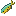  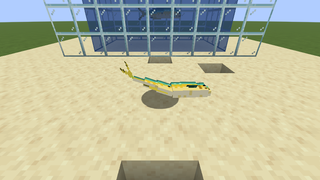 | Lampuka          | Dolphinfish                                         | Offshore, under floating rafts; season 15 Aug to Dec | done (art accepted 2026-11-18) |
|  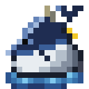 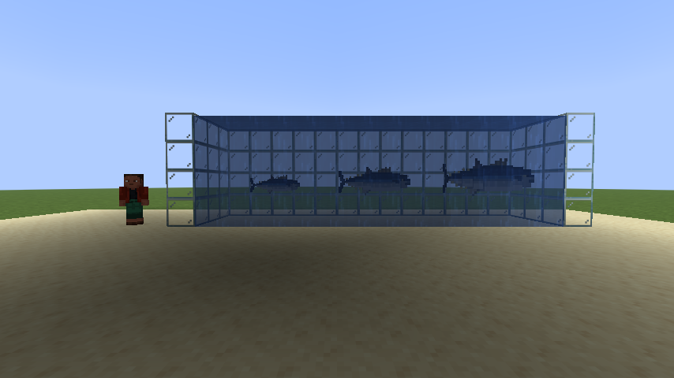                   | Tonn             | Atlantic bluefin tuna                               | Open sea, deep water; 2 to 4 blocks long             | done (art accepted 2026-11-18) |
| 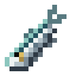 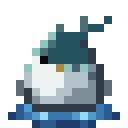  | Sardina          | Sardine                                             | Shoals everywhere                                    | done (art accepted 2026-11-18) |
| 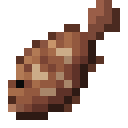 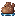              | Ċerna            | Dusky grouper                                       | Rocky reefs and caves (Dwejra, Blue Grotto)          | done (art accepted 2026-11-18) |
| 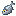  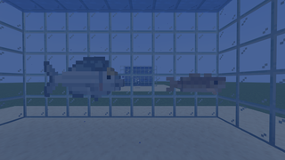       | Awrata           | Gilthead sea bream (also sargu, pagru, denċi, vopa) | Rocks, sand, seagrass                                | done (art accepted 2026-11-18) |
|          | Murina           | Mediterranean moray eel                             | Holes in rock, caves; night                          | done (art accepted 2026-11-18) |
|  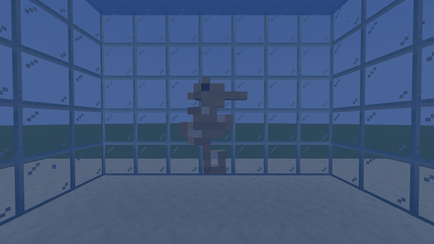                                    | Żiemel tal-Baħar | Seahorse                                            | Posidonia seagrass; drops nothing                    | done (art accepted 2026-11-18) |

## Tier B

| Picture                                                                                                                                      | Maltese    | English                      | Where                             | Status                         |
| -------------------------------------------------------------------------------------------------------------------------------------------- | ---------- | ---------------------------- | --------------------------------- | ------------------------------ |
|  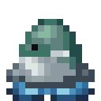 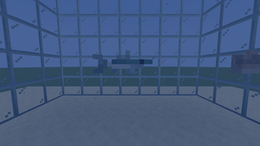                         | Inċova     | Anchovy                      | Shoals in open water              | done (art accepted 2026-11-18) |
| 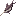         | Pixxispad  | Swordfish                    | Open sea                          | done (art accepted 2026-11-18) |
| 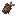  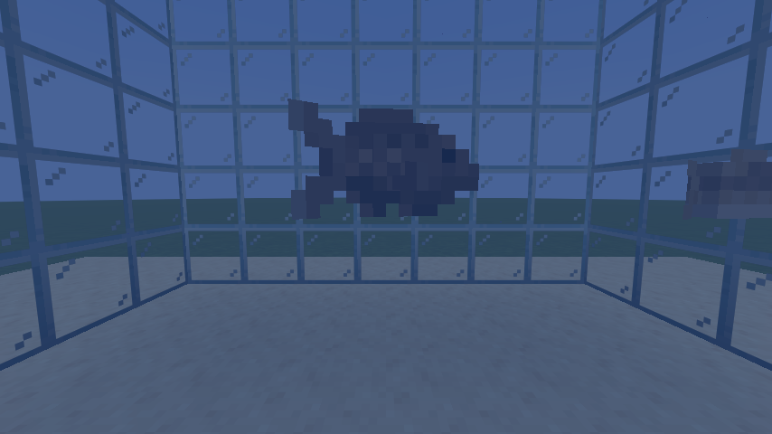                                     | Ċawl       | Damselfish                   | Shallow rocks                     | done (art accepted 2026-11-18) |
| 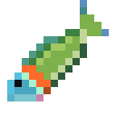 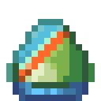 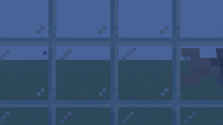 | Tird       | Wrasse                       | Shallow rocks, seagrass           | art accepted (model [[2026-11-19 Night fish models - nine pass, John Dory and petrica redo]]; icon and bucket [[2026-11-19 Night fish icons and buckets - most pass; John Dory, gallinella, lingwata bucket redo]]); spawn egg accepted ([[2026-11-19 Spawn eggs - all eight pass]]) |
| 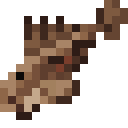 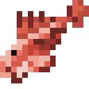 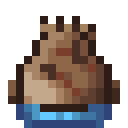 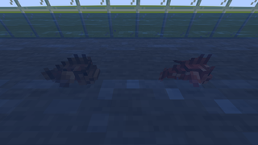 | Skorfna    | Scorpionfish (black and red) | Rocks, caves; venomous spines     | done (art accepted 2026-11-18: model, icon and bucket in black and red, one spawn egg; [[2026-11-18 Skorfna egg and mola mola model accepted]]) |
| 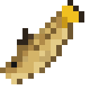 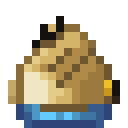 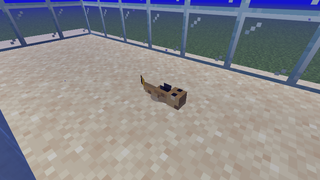 | Sawt       | Weever                       | Buried in beach sand; stings feet | art accepted (model [[2026-11-19 Night fish models - nine pass, John Dory and petrica redo]]; icon and bucket [[2026-11-19 Night fish icons and buckets - most pass; John Dory, gallinella, lingwata bucket redo]]); spawn egg accepted ([[2026-11-19 Spawn eggs - all eight pass]]) |
|   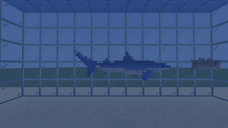 | Ħuta kaħla | Blue shark (all sharks)      | Open sea; rare near shore         | done (art accepted 2026-11-18) |
| 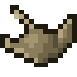 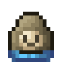 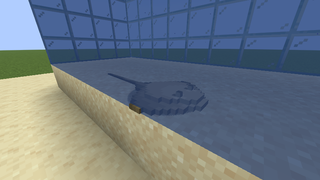 | Boll       | Common stingray              | Sand bottom                       | done (art accepted 2026-11-18: icon, bucket, spawn egg, model; [[2026-11-18 Boll model accepted]]) |
|                                                                                                                                              | Lionfish   | Lionfish                     | Reefs; invasive since 2016        | icon and bucket accepted; **model redone** (too fat, flat colours, [[2026-11-19 Redo verdicts - lizz bucket, lionfish, lingwata Q, gallinella, John Dory]]): slimmer, shaded, passed the critic in 2 rounds, waits for the owner; spawn egg placeholder ([[Night log/lionfish|art log]]) |

## Tier C

| Picture | Maltese          | English     | Where                   | Status  |
| ------- | ---------------- | ----------- | ----------------------- | ------- |
| 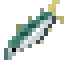 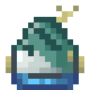 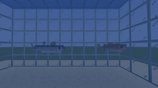 | Kavall           | Mackerel    | Shoals                  | art accepted (model [[2026-11-19 Night fish models - nine pass, John Dory and petrica redo]]; icon and bucket [[2026-11-19 Night fish icons and buckets - most pass; John Dory, gallinella, lingwata bucket redo]]); spawn egg accepted ([[2026-11-19 Spawn eggs - all eight pass]]) |
| 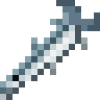 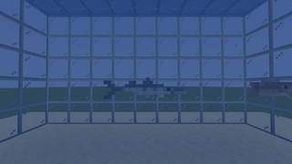 | Lizz             | Barracuda   | Near the coast, summer  | model and icon accepted ([[2026-11-19 Night fish models - nine pass, John Dory and petrica redo]], [[2026-11-19 Night fish icons and buckets - most pass; John Dory, gallinella, lingwata bucket redo]]); **bucket being redone** (read as a duck or seahorse, [[2026-11-19 Lizz bucket redo]]); spawn egg placeholder |
| 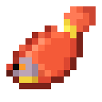 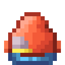 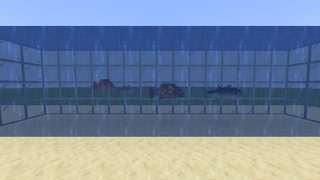 | Marzpan          | Parrotfish  | Shallow rocks           | art accepted (model [[2026-11-19 Night fish models - nine pass, John Dory and petrica redo]]; icon and bucket [[2026-11-19 Night fish icons and buckets - most pass; John Dory, gallinella, lingwata bucket redo]]); spawn egg accepted ([[2026-11-19 Spawn eggs - all eight pass]]) |
| 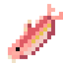 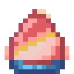 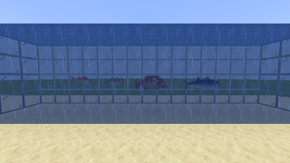 | Trilja           | Red mullet  | Sand, harbours          | art accepted (model [[2026-11-19 Night fish models - nine pass, John Dory and petrica redo]], after 8 critic rounds; icon and bucket [[2026-11-19 Night fish icons and buckets - most pass; John Dory, gallinella, lingwata bucket redo]]); spawn egg accepted ([[2026-11-19 Spawn eggs - all eight pass]]) ([[Night log/trilja|egg log]]) |
| 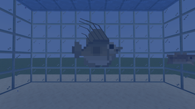 | Pixxi San Pietru | John Dory   | Mid-depth               | model accepted with redone spines ([[2026-11-19 John Dory spines accepted]]); icon accepted; **bucket redrawn again, waiting for the owner** (the mouth looked like a magnet or duck bill; critic PASS in round 2, two of three blind readers see a fish mouth; was too flat and fat, [[2026-11-19 Night fish icons and buckets - most pass; John Dory, gallinella, lingwata bucket redo]]); spawn egg placeholder |
| 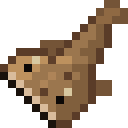 | Petriċa          | Anglerfish  | Deep mud                | **model redone, waiting for the owner** (doesn't look like an anglerfish; in water it has a normal fish shape, [[2026-11-19 Night fish models - nine pass, John Dory and petrica redo]]; the redo gave up after 8 critic rounds, the closest one installed, [[Night log/petrica]]); icon and bucket accepted ([[2026-11-19 Night fish icons and buckets - most pass; John Dory, gallinella, lingwata bucket redo]]); spawn egg placeholder |
| 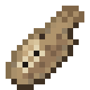 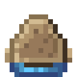 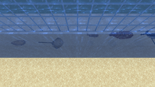 | Lingwata         | Sole        | Sand bottom             | model and icon accepted ([[2026-11-19 Night fish models - nine pass, John Dory and petrica redo]], [[2026-11-19 Night fish icons and buckets - most pass; John Dory, gallinella, lingwata bucket redo]]); **bucket being redone upright** ([[2026-11-19 Lingwata bucket - sole standing upright]]; 3 critic rounds failed, upright try P in for the owner to judge, [[Night log/lingwata]]); spawn egg accepted ([[2026-11-19 Spawn eggs - all eight pass]]) ([[Night log/lingwata|egg log]]) |
| 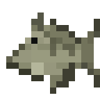 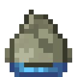 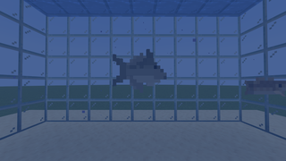 | Ħmar             | Triggerfish | Rocks                   | art accepted (model [[2026-11-19 Night fish models - nine pass, John Dory and petrica redo]]; icon and bucket [[2026-11-19 Night fish icons and buckets - most pass; John Dory, gallinella, lingwata bucket redo]]); spawn egg accepted ([[2026-11-19 Spawn eggs - all eight pass]]) ([[Night log/hmar|egg log]]) |
| 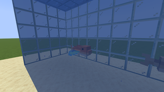 | Gallinella       | Gurnard     | Sand; walks on its fins | model accepted ([[2026-11-19 Night fish models - nine pass, John Dory and petrica redo]]); bucket accepted ([[2026-11-19 Redo verdicts - lizz bucket, lionfish, lingwata Q, gallinella, John Dory]]); **icon redrawn again, waiting for the owner** (the fin looked disconnected; now it grows out of the side behind the head, critic passed, [[Night log/gallinella]]); spawn egg placeholder |
|    | Pixxiluna (also qamar, pixxitanbur) | Ocean sunfish (mola mola) | Deep sea, basks at the surface in the sun; extremely rare, caught with jellyfish meat once fishing is overhauled ([[Mola mola]]) | model accepted ([[2026-11-18 Skorfna egg and mola mola model accepted]]); icon A accepted ([[2026-11-19 Night fish icons and buckets - most pass; John Dory, gallinella, lingwata bucket redo]]); **bucket removed**: it can't be captured, drops nothing and escapes when hurt ([[2026-11-19 Mola mola - can be found, not captured; escapes when hurt; basks in the sun]]); spawn egg accepted ([[2026-11-19 Spawn eggs - all eight pass]]) ([[Night log/mola_mola|egg log]]); name, rarity and season still open ([[Mola mola]]) |

## Other sea life

| Picture | Maltese | English | Where | Status |
| --- | --- | --- | --- | --- |
|  | Qarnita | Octopus | Rocks, holes, caves | planned |
|  | Granċ | Crab | Rocky shores, tide pools | planned |
|   | Brama | Mauve stinger | Open sea; summer swarms; stings, glows green at night | done (model and spawn egg accepted; no item or bucket: it drops venom and meat; [[Jellyfish]]) |
|   | Brama | Fried-egg jellyfish | Bays, late summer; harmless | done (model and spawn egg accepted; no item or bucket: it drops meat; [[Jellyfish]]) |
|   | Brama | Portuguese man o' war | Floats on the open sea, rare; long stinging tentacles | done (model and spawn egg A accepted; no item or bucket: it drops venom and meat; [[2026-11-18 Man o' war egg A accepted]]) |
|  | Rizza | Sea urchin (block) | Rocks in shallow water | planned |
|  | Awwista | Lobster | Sea caves, deep rock | planned |
|  | Gambli | Shrimp | Deep sea | planned |
|  | Stilla tal-Baħar | Starfish (block) | Rocks, seagrass | planned |
|  | Artikla | Sea anemone (block) | Rocks | planned |
|  | Nakkra | Pen shell (block) | Seagrass | planned |

## How pictures are added

When a fish's art is accepted, its in-game icon, its spawn egg (and a shot of the live fish) goes into `docs/Creatures and Plants/images/` and is embedded in the Picture column, e.g. ``, and its status becomes done.
