# Fish progress

Every fish and sea creature planned for the mod, with a picture of each as it is made (2026-11-17). There are no placeholder or real-life photos here: the picture column fills in with the in-game art once the owner accepts it.

- **Status:** planned, building (placeholder art), or done (art accepted by the owner).
- The full list with notes is [[Content mod list]] section 6; the built fish are described in [[Fish]].
- Tier A: [[2026-11-17 Tier A fish - start building]].

## Tier A (being built now)

> [!todo] Before publishing
> Check the lampuka, tonn and sardina buckets: they show the whole fish with its tail. From the ċerna on, buckets show the head rising out of the water, as vanilla does ([[2026-11-18 Cerna bucket accepted; older buckets checked before release]]).

| Picture                                                                        | Maltese          | English                                             | Where                                                | Status                                                       |
| ------------------------------------------------------------------------------ | ---------------- | --------------------------------------------------- | ---------------------------------------------------- | ------------------------------------------------------------ |
|  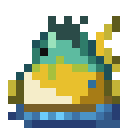  | Lampuka          | Dolphinfish                                         | Offshore, under floating rafts; season 15 Aug to Dec | done (art accepted 2026-11-18)                               |
|             | Tonn             | Atlantic bluefin tuna                               | Open sea, deep water; 2 to 4 blocks long             | done (art accepted 2026-11-18)                               |
|   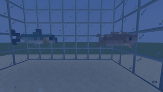 | Sardina          | Sardine                                             | Shoals everywhere                                    | done (art accepted 2026-11-18)                               |
|   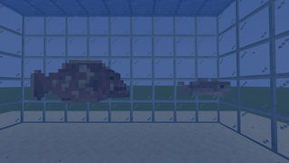       | Ċerna            | Dusky grouper                                       | Rocky reefs and caves (Dwejra, Blue Grotto)          | done (art accepted 2026-11-18)                               |
|    | Awrata | Gilthead sea bream (also sargu, pagru, denċi, vopa) | Rocks, sand, seagrass | done (art accepted 2026-11-18) |
| 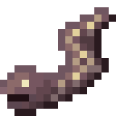 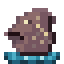 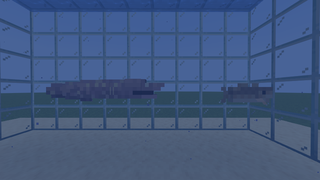 | Murina | Mediterranean moray eel | Holes in rock, caves; night | done (art accepted 2026-11-18) |
| 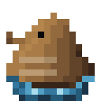  | Żiemel tal-Baħar | Seahorse                                            | Posidonia seagrass; drops nothing                    | done (art accepted 2026-11-18) |

## Tier B

| Picture                                           | Maltese    | English                                      | Where                             | Status                                                                                       |
| ------------------------------------------------- | ---------- | -------------------------------------------- | --------------------------------- | -------------------------------------------------------------------------------------------- |
| 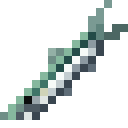   | Inċova     | Anchovy                                      | Shoals in open water              | done (art accepted 2026-11-18) |
|  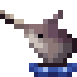 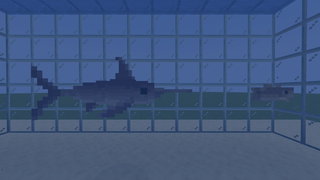 | Pixxispad  | Swordfish                                    | Open sea                          | done (art accepted 2026-11-18) |
|  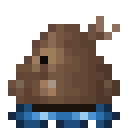  | Ċawl       | Damselfish                                   | Shallow rocks                     | done (art accepted 2026-11-18) |
|                                                   | Tird       | Wrasse                                       | Shallow rocks, seagrass           | planned                                                                                      |
|                                                   | Skorfna    | Scorpionfish                                 | Rocks, caves; venomous spines     | planned                                                                                      |
|                                                   | Sawt       | Weever                                       | Buried in beach sand; stings feet | planned                                                                                      |
|    | Ħuta kaħla | Blue shark (all sharks)                      | Open sea; rare near shore         | done (art accepted 2026-11-18) |
|                                                   | Boll       | Stingray (all rays, incl. the Maltese skate) | Sand bottom                       | planned                                                                                      |
|                                                   | Lionfish   | Lionfish                                     | Reefs; invasive since 2016        | planned                                                                                      |

## Tier C

| Picture | Maltese | English | Where | Status |
| --- | --- | --- | --- | --- |
|  | Kavall | Mackerel | Shoals | planned |
|  | Lizz | Barracuda | Near the coast, summer | planned |
|  | Marzpan | Parrotfish | Shallow rocks | planned |
|  | Trilja | Red mullet | Sand, harbours | planned |
|  | Pixxi San Pietru | John Dory | Mid-depth | planned |
|  | Petriċa | Anglerfish | Deep mud | planned |
|  | Lingwata | Sole | Sand bottom | planned |
|  | Ħmar | Triggerfish | Rocks | planned |
|  | Gallinella | Gurnard | Sand; walks on its fins | planned |

## Other sea life

| Picture | Maltese | English | Where | Status |
| --- | --- | --- | --- | --- |
|  | Qarnita | Octopus | Rocks, holes, caves | planned |
|  | Granċ | Crab | Rocky shores, tide pools | planned |
|  | Brama | Jellyfish | Open sea; summer swarms | planned |
|  | Rizza | Sea urchin (block) | Rocks in shallow water | planned |
|  | Awwista | Lobster | Sea caves, deep rock | planned |
|  | Gambli | Shrimp | Deep sea | planned |
|  | Stilla tal-Baħar | Starfish (block) | Rocks, seagrass | planned |
|  | Artikla | Sea anemone (block) | Rocks | planned |
|  | Nakkra | Pen shell (block) | Seagrass | planned |

## How pictures are added

When a fish's art is accepted, its in-game icon, its spawn egg (and a shot of the live fish) goes into `docs/Creatures and Plants/images/` and is embedded in the Picture column, e.g. ``, and its status becomes done.
