# Food progress

What is in the mod now and what isn't yet, with a picture of each (2026-11-17).

- **In the mod** means the **art** is done and accepted by the owner: the item or dish has its picture, its name and its id, and it shows in the game. **Nothing has gameplay yet:** no recipes, food values (except placeholders on the placed dishes) or cooking. That waits for the owner's go-ahead.
- **Not yet** means it is in the catalogue ([[Food design]]) but nothing is drawn. Those pictures are free photos from Wikimedia Commons, with the licence and author under each. They show what the food is, not how it will look in the game. A few are a similar dish from elsewhere when no free photo of the Maltese one exists; those say so.
- Vanilla foods the mod uses as they are (section 2 of [[Food design]]) are not listed.
- The codes (C1, D15, X6...) are the catalogue numbers in [[Food design]].

| | In the mod | Not yet |
|---|---|---|
| Items | 35 | |
| Placed dishes (eaten in slices) | 4 | |
| Kitchen blocks | 3 (kenur, borma, borma with stuffat) | |
| Crops, trees, wild food, animal and sea products | 1 (the lampuka) | 47 |
| Base ingredients and imports | the 3 ġbejniet and the broth (as 2 soups) | 31 |
| Catalogue dishes | 28 | 43 |
| Drinks | Kinnie (3 items) | 5 |

## In the mod

### Bread

| Picture | Food | Id (`mimcontent:`) | Notes |
|---|---|---|---|
| 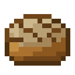 | **Ħobż tal-Malti** (D1) | `hobz_malti` | the crusty round sourdough loaf |
| 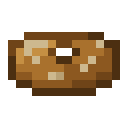 | **Ftira** | `ftira` | the ring-shaped flat loaf |
| 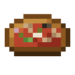 | **Ħobż biż-Żejt** (D2) | `hobz_bizzejt` | bread with kunserva, oil, tomato, capers and olives |
| 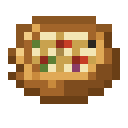 | **Ftira Għawdxija** (D3) | `ftira_ghawdxija` | the Gozo ftira with potato and ġbejna |
|  | **Galletti** (D7) | `galletti` | water crackers |

### Pastizzi

| Picture | Food | Id (`mimcontent:`) | Notes |
|---|---|---|---|
| 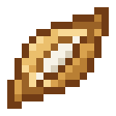 | **Pastizz tal-Irkotta** (D4) | `pastizz_irkotta` | the flagship |
| 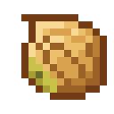 | **Pastizz tal-Piżelli** (D5) | `pastizz_pizelli` |  |
| 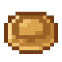 | **Pastizz tax-Xema' tal-Irkotta** (D4) | `pastizz_xema_irkotta` | the round one |
| 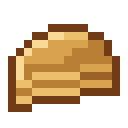 | **Pastizz tax-Xema' tal-Piżelli** (D5) | `pastizz_xema_pizelli` | the half-moon |

### Cheese

| Picture | Food | Id (`mimcontent:`) | Notes |
|---|---|---|---|
|  | **Ġbejna (fresh)** (D12) | `gbejna` |  |
| 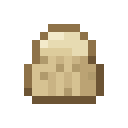 | **Ġbejna Niexfa (dried)** (D12) | `gbejna_niexfa` |  |
| 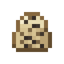 | **Ġbejna tal-Bżar (peppered)** (D12) | `gbejna_tal_bzar` |  |

### Fish

| Picture | Food | Id (`mimcontent:`) | Notes |
|---|---|---|---|
| 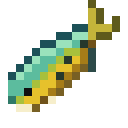 | **Lampuka (the caught fish)** (4d) | `lampuka` | beside vanilla cod and salmon |
| 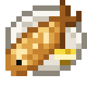 | **Lampuka Moqlija** (D33) | `lampuka_moqlija` | whole fried lampuka on a plate with lemon |

### Bowls and soups

| Picture | Food | Id (`mimcontent:`) | Notes |
|---|---|---|---|
|  | **Stuffat tal-Fenek** (D21) | `stuffat_fenek` | the national dish |
| 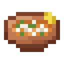 | **Aljotta** (D15) | `aljotta` | fish soup |
|  | **Stuffat tal-Qarnit** (D35) | `stuffat_qarnit` | octopus stew |
| 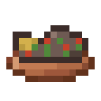 | **Bigilla** (D10) | `bigilla` | broad bean dip |
| 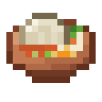 | **Soppa tal-Armla** (D16) | `soppa_tal_armla` | widow's soup |
| 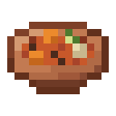 | **Minestra** (D17) | `minestra` | vegetable soup |
| 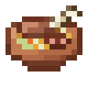 | **Kawlata** (D18) | `kawlata` | cabbage and pork soup |
| 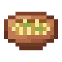 | **Kusksu** (D19) | `kusksu` | kusksu and broad bean soup |
| 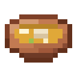 | **Brodu tat-Tiġieġ** (D20) | `brodu_tat_tigieg` | chicken broth |
| 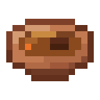 | **Brodu tal-Laħam** (D20) | `brodu_tal_laham` | beef broth |

### Sweets

| Picture | Food | Id (`mimcontent:`) | Notes |
|---|---|---|---|
| 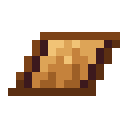 | **Imqaret** (D40) | `imqaret` | date pastries |
| 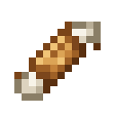 | **Kannoli** (D42) | `kannoli` | plain ricotta |
|  | **Qagħaq tal-Għasel** (D41) | `qaghaq_ghasel` | honey rings, Christmas |
|  | **Ġelat Malti** (D68) | `gelat_malti` | ġelat tan-nanna: cream scoops, almonds, glacé cherries |

### Pastries and bread rings

| Picture | Food | Id (`mimcontent:`) | Notes |
|---|---|---|---|
| 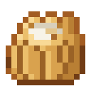 | **Qassata tal-Irkotta** (D6) | `qassata_irkotta` | round, pleated, ricotta in the open top |
| 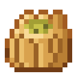 | **Qassata tal-Piżelli** (D6) | `qassata_pizelli` | the same pastry with peas |
| 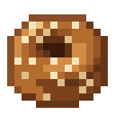 | **Qagħqa tal-Ħmira** (D8) | `qaghaq_hmira` | glossy brown sesame bread ring |
|  | **Qagħqa tal-Appostli** (D9) | `qaghqa_appostli` | big Holy Week ring with almonds |

### Drinks

| Picture | Food | Id (`mimcontent:`) | Notes |
|---|---|---|---|
|  | **Kinnie (bottle)** (X6) | `kinnie` | real label; a plain fallback is ready |
|  | **Kinnie Can** (X6) | `kinnie_can` |  |
|  | **Glass of Kinnie** (X6) | `kinnie_glass` |  |

### Placed dishes, eaten in 6 slices like a cake

Place one on a table and use it to eat a slice. They share one block class, `SliceDishBlock`.

#### Ross il-Forn (D26)

`ross_il_forn`: foil tray.

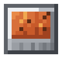

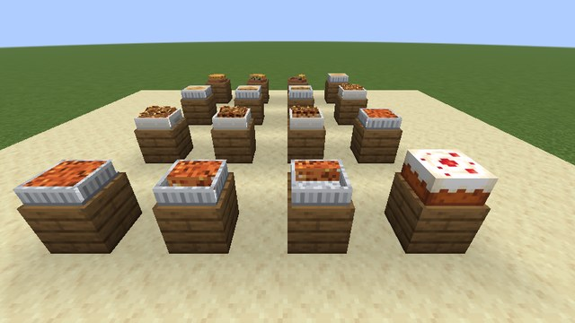

#### Imqarrun il-Forn (D28)

`imqarrun_il_forn`: white ceramic dish, baked penne on top.

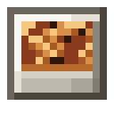

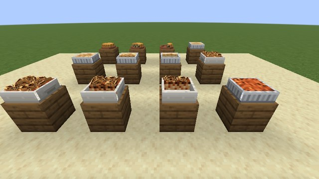

#### Timpana (D27)

`timpana`: foil tray with a pastry lid.

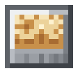

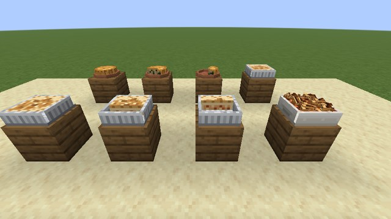

#### Torta tal-Lampuki (D34)

`torta_lampuki`: round pie in a terracotta dish, eaten in wedges.

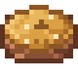

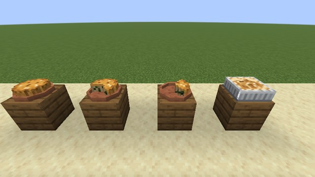

### Kitchen blocks

The kenur (a limestone stove that can be lit and hold a pot) and the borma (a clay stew pot, empty or full of stuffat). The owner said these "can pass for now".

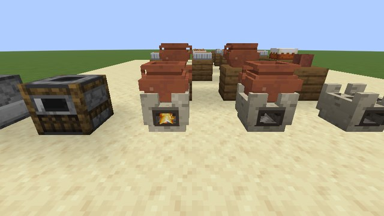

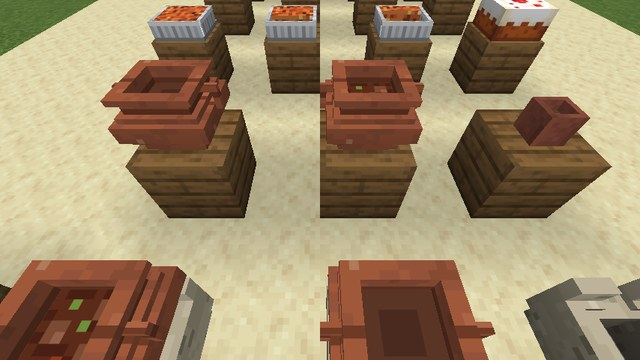

## Not yet

Grouped as in [[Food design]]. The lampuka, the ġbejniet, the broths and Kinnie are left out here because they are in the mod.

### Crops

| Picture | Food | Photo |
|---|---|---|
|  | **Tomato (tadam)** (C1) | [CC BY-SA 3.0, Softeis](https://commons.wikimedia.org/wiki/File:Tomato_je.jpg) |
|  | **Onion (basal)** (C2) | [CC BY-SA 3.0, Colin](https://commons.wikimedia.org/wiki/File:Mixed_onions.jpg) |
|  | **Garlic (tewm)** (C3) | [CC BY-SA 4.0, Ivar Leidus](https://commons.wikimedia.org/wiki/File:Garlic_bulbs_and_cloves.jpg) |
|  | **Broad bean (ful)** (C4) | [CC BY-SA 3.0, Rasbak](https://commons.wikimedia.org/wiki/File:Vicia_faba_pod_(02).jpg) |
|  | **Pea (piżelli)** (C5) | [CC BY 4.0, Steffen Bauer (saatpilot.de)](https://commons.wikimedia.org/wiki/File:Pisum_sativum_Early_Onward_(garden_pea),_harvested_pods_(SaatPilot).jpg) |
|  | **Grapevine (dielja)** (C6) | [CC BY 2.0, eflon (Alex from Ithaca, NY)](https://commons.wikimedia.org/wiki/File:Edle_Weinrebe,_%27Vitis_vinifera%27_subsp._%27vinifera.jpg) |
|  | **Round marrow (qargħa bagħli)** (C7) | [CC BY-SA 3.0, Tiia Monto](https://commons.wikimedia.org/wiki/File:Round_zucchini_2.jpg) |
|  | **Cauliflower (pastard)** (C8) | [CC BY-SA 4.0, Rjcastillo](https://commons.wikimedia.org/wiki/File:Brassica_oleracea_var._botrytis_(Coliflor).jpg) |
|  | **Cabbage (kaboċċa)** (C9) | [CC BY-SA 4.0, Yusuf Muhammed Thanni](https://commons.wikimedia.org/wiki/File:Cabbage_on_farm.jpg) |
|  | **Kohlrabi (gidra)** (C10) | [CC0, Unknown](https://commons.wikimedia.org/wiki/File:Brassica_oleracea_var._gongylodes_(kohlrabi).jpg) |
|  | **Artichoke (qaqoċċ)** (C11) | [CC BY-SA 4.0, Acabashi](https://commons.wikimedia.org/wiki/File:Globe_artichoke_Cynara_cardunculus_at_Riverside_Moorings,_Shoreham,_West_Sussex,_England.jpg) |
|  | **Aubergine (brunġiel)** (C12) | [CC BY-SA 3.0, Grey Geezer](https://commons.wikimedia.org/wiki/File:Aubergine-Varianten.JPG) |
|  | **Sweet pepper (bżar aħdar)** (C13) | [CC BY-SA 3.0, Nikodem Nijaki](https://commons.wikimedia.org/wiki/File:Capsicum_annuum_fruits_IMGP0049.jpg) |
|  | **Spinach (spinaċi)** (C14) | [CC BY 3.0, Nillerdk](https://commons.wikimedia.org/wiki/File:Spinach_leaves.jpg) |
|  | **Herbs: basil, mint, marjoram, parsley** (C15) | [CC BY-SA 4.0, Netha Hussain](https://commons.wikimedia.org/wiki/File:Basil_plant_in_a_pot_02.jpg) |
|  | **Coriander (kosbor)** (C16) | [CC BY-SA 4.0, Sanjay Acharya](https://commons.wikimedia.org/wiki/File:Coriander_Seeds.jpg) |
|  | **Anise (ħlewwa)** (C17) | [CC BY-SA 3.0, OttawaAC](https://commons.wikimedia.org/wiki/File:Anise_Seed.jpg) |
|  | **Sesame (ġulġlien)** (C18) | [CC BY-SA 3.0, Sanjay ach](https://commons.wikimedia.org/wiki/File:Sa_white_sesame_seeds.jpg) |
|  | **Cumin (kemmun)** (C19) | [CC BY-SA 4.0, Sanjay Acharya](https://commons.wikimedia.org/wiki/File:Seeds_of_Cumin.jpg) |

### Fruit and nut trees

| Picture | Food | Photo |
|---|---|---|
|  | **Olive (żebbuġ)** (T1) | [CC BY-SA 4.0, PolluxWorld](https://commons.wikimedia.org/wiki/File:Old_olive_tree_in_Bidnija,_Malta_trunks.png) |
|  | **Carob (ħarrub)** (T2) | [CC BY-SA 4.0, Zeynel Cebeci](https://commons.wikimedia.org/wiki/File:Ceratonia_siliqua_-_Ke%C3%A7iboynuzu.jpg) |
|  | **Fig (tin)** (T3) | [CC BY 3.0, Ανώνυμος Βικιπαιδιστής](https://commons.wikimedia.org/wiki/File:Ficus_carica_fruits_-_%CF%8E%CF%81%CE%B9%CE%BC%CE%B1_%CF%83%CF%8D%CE%BA%CE%B1.jpg) |
|  | **Orange (larinġ)** (T4) | [CC BY-SA 4.0, Rhododendrites](https://commons.wikimedia.org/wiki/File:Blood_orange_slice.jpg) |
|  | **Lemon (lumi)** (T5) | [CC BY-SA 2.5, André Karwath aka Aka](https://commons.wikimedia.org/wiki/File:Lemon.jpg) |
|  | **Almond (lewż)** (T6) | [CC BY-SA 4.0, GeXeS](https://commons.wikimedia.org/wiki/File:Almond_in_an_open_shell.jpg) |
|  | **Pomegranate (rummien)** (T7) | [CC BY-SA 4.0, Ivar Leidus](https://commons.wikimedia.org/wiki/File:Pomegranate_fruit_-_whole_and_piece_with_arils.jpg) |
|  | **Mulberry (ċawsli)** (T8) | [CC BY-SA 4.0, Beko](https://commons.wikimedia.org/wiki/File:Black_mulberry_fruit_(Morus_nigra).jpg) |
|  | **Loquat (naspli)** (T9) | [CC BY 2.0, Ed Uthman](https://commons.wikimedia.org/wiki/File:Loquat_fruit_and_foliage_(Eriobotrya_japonica).jpg) |

### Wild food

| Picture | Food | Photo |
|---|---|---|
|  | **Capers (kappar)** (W1) | [CC BY-SA 4.0, Matosu28](https://commons.wikimedia.org/wiki/File:Caper_bush.jpg) |
|  | **Prickly pear (bajtar tax-xewk)** (W2) | [CC BY-SA 4.0, Status Post](https://commons.wikimedia.org/wiki/File:Prickly_pear_in_Malta.jpg) |
|  | **Wild fennel (busbież)** (W3) | [CC BY-SA 2.0, Evelyn Simak](https://commons.wikimedia.org/wiki/File:Wild_fennel_(Foeniculum_vulgare)_-_geograph.org.uk_-_5471346.jpg) |
|  | **Thyme (sagħtar)** (W4) | [CC BY-SA 3.0, Denis Barthel (talk)](https://commons.wikimedia.org/wiki/File:Thymbra_capitata_Ghajn_Tuffieha_Malta_02.jpg) |
|  | **Snails (għakruxa)** (W5) | [CC BY 2.0, Zachi Evenor](https://commons.wikimedia.org/wiki/File:Snail-wiki-120-Zachi-Evenor.jpg) |
|  | **Wild asparagus (spraġ)** (W6) | [CC BY-SA 3.0, Frank Vincentz](https://commons.wikimedia.org/wiki/File:Malta_-_Mellieha_-_Triq_l-Armier_-_Asparagus_aphyllus_01_ies.jpg) |
|  | **Borage (fidloqqom)** (W7) | [CC BY-SA 4.0, Dominicus Johannes Bergsma](https://commons.wikimedia.org/wiki/File:Borago_officinalis._Locatie,_De_Kruidhof.jpg) |
|  | **Samphire (busbies il-baħar)** (W8) | [CC BY-SA 3.0, Alvesgaspar](https://commons.wikimedia.org/wiki/File:Crithmum_AUgust_2001-1.jpg) |

### From animals

| Picture | Food | Photo |
|---|---|---|
|  | **Sheep's milk** (A1) | [CC BY-SA 4.0, Godwin Borg](https://commons.wikimedia.org/wiki/File:Sheep_at_the_Petting_Farm_Ta%27_Qali.jpg) sheep at Ta' Qali |
|  | **Thyme honey** (A2) | [CC BY-SA 3.0, Akarlovic](https://commons.wikimedia.org/wiki/File:Med_u_sacu_karlovic1.jpg) |
| (no free photo found) | **Carob honey** (A3) | |
|  | **Squid meat** (A4) | [CC BY-SA 3.0, David Monniaux](https://commons.wikimedia.org/wiki/File:Iwami_squid_drying_DSC01868.jpg) |

### From the sea

| Picture | Food | Photo |
|---|---|---|
|  | **Tuna (tonn)** (S1) | [Public domain, Unknown authorUnknown author](https://commons.wikimedia.org/wiki/File:Thunnus_thynnus_2.jpg) |
|  | **Sardine / anchovy (sardina / inċova)** (S2) | [CC BY-SA 4.0, Erasmus Kamugisha](https://commons.wikimedia.org/wiki/File:Kigoma%27s_small_dried_sardines_-_fish_in_a_local_market.jpg) |
|  | **Octopus (qarnita)** (S3) | [Public domain, Comingio Merculiano (1845-1915) in Jatta Giuseppe (1860-1903)](https://commons.wikimedia.org/wiki/File:Octopus_vulgaris_Merculiano.jpg) |
|  | **Sea bream, grouper (awrata, ċerna)** (S4) | [CC BY-SA 3.0, Christoph Hübner](https://commons.wikimedia.org/wiki/File:Sparus_aurata_juvenile.jpg) |
|  | **Swordfish (pixxispad)** (S5) | [CC BY-SA 3.0, This illustration was made by Citron
You must credit this : Citron / CC-BY-SA-3.](https://commons.wikimedia.org/wiki/File:Xiphias_gladius_stuffed.jpg) |
|  | **Sea urchin roe (rizzi)** (S6) | [CC BY-SA 4.0, Diego Delso](https://commons.wikimedia.org/wiki/File:Erizo_de_mar_(Paracentrotus_lividus),_Cabo_de_Palos,_Espa%C3%B1a,_2022-07-15,_DD_96.jpg) |
|  | **Red mullet, mackerel (trilja, kavall)** (S7) | [CC BY 4.0, Stephane Lesbats (IFREMER, Pôle Images, Centre Bretagne - ZI de la Pointe du Dia](https://commons.wikimedia.org/wiki/File:Etal_de_poissonnerie_(Ifremer_00528-64020_-_47206).jpg) |

### Base ingredients

| Picture | Food | Photo |
|---|---|---|
|  | **Sea salt (melħ)** (I1) | [CC BY-SA 4.0, Julijana9991](https://commons.wikimedia.org/wiki/File:Salt_pans,Gozo.jpg) the Gozo salt pans |
|  | **Flour (dqiq)** (I2) | [CC BY-SA 4.0, هارون يحيى](https://commons.wikimedia.org/wiki/File:Wheat-flour.jpg) |
|  | **Dough (għaġina)** (I3) | [CC0, Gageills](https://commons.wikimedia.org/wiki/File:Risen_bread_dough.jpg) |
|  | **Pastry (għaġina tal-pastizzi)** (I4) | [CC BY-SA 3.0, Roozitaa](https://commons.wikimedia.org/wiki/File:Making_puff_pastry_(butter_and_Water_dough_)_5.jpg) |
|  | **Pasta (għaġin)** (I5) | [CC BY 2.0, Joy](https://commons.wikimedia.org/wiki/File:Making_a_better_homemade_pasta_-_16670047286.jpg) |
|  | **Butter (butir)** (I6) | [CC BY-SA 4.0, Salicyna](https://commons.wikimedia.org/wiki/File:Block_of_butter_20200928_080207.jpg) |
|  | **Ricotta (irkotta)** (I7) | [CC BY 2.0, Paoletta S.](https://commons.wikimedia.org/wiki/File:Ricotta.jpeg) |
|  | **Olive oil (żejt taż-żebbuġ)** (I8) | [CC BY-SA 4.0, Lemone](https://commons.wikimedia.org/wiki/File:Olive_oil_from_Oneglia.jpg) |
|  | **Cured olives (żebbuġ)** (I9) | [CC BY-SA 4.0, Famartin](https://commons.wikimedia.org/wiki/File:2019-11-28_14_33_54_A_bowl_of_olives_laid_out_for_Thanksgiving_Dinner_in_the_Parkway_Village_section_of_Ewing_Township,_Mercer_County,_New_Jersey.jpg) |
|  | **Brined capers (kappar)** (I10) | [CC BY-SA 3.0, Whitebox at en.wikipedia](https://commons.wikimedia.org/wiki/File:Capers_jar.jpg) |
|  | **Kunserva** (I11) | [CC BY-SA 3.0, SKopp](https://commons.wikimedia.org/wiki/File:Tomato_paste_on_spoon.jpg) |
|  | **Sun-dried tomatoes (tadam imqadded)** (I12) | [CC BY 2.0, Andrew Deacon](https://commons.wikimedia.org/wiki/File:Sun-dried_tomatoes.jpg) |
|  | **Zalza (tomato sauce)** (I13) | [CC0, Dennis Klein klein2](https://commons.wikimedia.org/wiki/File:Fresh_Tomato_Sauce_(Unsplash).jpg) |
|  | **Ħwawar (herbs)** (I14) | [CC BY 2.0, Shixart1985](https://commons.wikimedia.org/wiki/File:Freshly_picked_herbs_held_high_against_a_lush_green_backdrop_in_an_outdoor_farm_setting.jpg) |
|  | **Mince (laħam ikkappuljat)** (I15) | [CC0, Erwin](https://commons.wikimedia.org/wiki/File:Minced_meat.jpg) |
|  | **Breadcrumbs (frak tal-ħobż)** (I16) | [CC BY-SA 3.0, Yvwv](https://commons.wikimedia.org/wiki/File:Breadcrumb.jpg) |
|  | **Anchovies (inċova)** (I17) | [CC BY-SA 4.0, Kolforn (Kolforn)
I'd appreciate if you could mail me (Kolforn@gmail.com) if you](https://commons.wikimedia.org/wiki/File:14-07-2017_Bottle_of_Anchovies_fillets_in_olive_oil,_Pit%C3%A9u.JPG) |
|  | **Tuna in oil (tonn fiż-żejt)** (I18) | [CC BY 3.0, Tamorlan](https://commons.wikimedia.org/wiki/File:Lata_de_at%C3%BAn-Albo.jpg) |
|  | **Intrita (almond paste)** (I19) | [CC0, Carmen Eisbär](https://commons.wikimedia.org/wiki/File:Marzipan_carrots_(marchpane_almond_paste)_Marzipanm%C3%B6hren_(17020281571).jpg) marzipan, the nearest free photo |
|  | **Orange peel (qoxra tal-larinġ)** (I20) | [CC BY-SA 2.0, Veganbaking.net from USA](https://commons.wikimedia.org/wiki/File:Candied_Orange_Peel_(4175930962).jpg) |
|  | **Raisins (żbib)** (I21) | [CC BY-SA 4.0, Jacek Halicki](https://commons.wikimedia.org/wiki/File:2023_Rodzynki_(2).jpg) |
|  | **Dried figs (tin imqadded)** (I22) | [CC BY-SA 3.0, Madhif](https://commons.wikimedia.org/wiki/File:Figue_sec.JPG) |
|  | **Carob syrup (ġulepp tal-ħarrub)** (I23) | [CC BY-SA 4.0, Silassouille](https://commons.wikimedia.org/wiki/File:Carob_syrup_spoon.jpg) |

### Imported goods

| Picture | Food | Photo |
|---|---|---|
|  | **Rice (ross)** (M1) | [CC BY-SA 4.0, JoabJacob](https://commons.wikimedia.org/wiki/File:Rice_Grains_at_Bakin_Dogo_Market_Kaduna_North.jpg) |
|  | **Black pepper (bżar)** (M2) | [CC BY 2.0, Ryan Snyder](https://commons.wikimedia.org/wiki/File:Black_Peppercorns_(4422070187).jpg) |
|  | **Dates (tamal)** (M3) | [CC BY 2.0, Michael Gaylard from Horsham, UK](https://commons.wikimedia.org/wiki/File:2019_Dates_(48608157288).jpg) |
|  | **Cloves (qronfol)** (M4) | [CC BY-SA 4.0, Jacek Halicki](https://commons.wikimedia.org/wiki/File:2023_Go%C5%BAdziki.jpg) |
|  | **Cinnamon (kannella)** (M5) | [CC BY-SA 3.0, Luc Viatour](https://commons.wikimedia.org/wiki/File:Canelle_Cinnamomum_burmanni_Luc_Viatour.jpg) |
|  | **Dried chestnuts (qastan)** (M6) | [CC BY-SA 2.0, Alpha from Melbourne, Australia](https://commons.wikimedia.org/wiki/File:Roasted_Chestnuts,_peeled_by_avlxyz.jpg) |
|  | **Cocoa (kawkaw)** (M7) | [CC BY-SA 3.0, Roger Culos](https://commons.wikimedia.org/wiki/File:Theobroma_cacao_MHNT.BOT.2004.0.204.jpg) |
|  | **Tea (te)** (M8) | [CC BY-SA 3.0, Nevit Dilmen](https://commons.wikimedia.org/wiki/File:Glass_of_tea_05119.jpg) |

### Dishes

| Picture                                                                                                                                                                                                                                                                      | Food                                                  | Photo                                                                                                                                                                                      |
| ---------------------------------------------------------------------------------------------------------------------------------------------------------------------------------------------------------------------------------------------------------------------------- | ----------------------------------------------------- | ------------------------------------------------------------------------------------------------------------------------------------------------------------------------------------------ |
| (no free photo found)                                                                                                                                                                                                                                                        | **Arjoli** (D11)                                      |                                                                                                                                                                                            |
| (no free photo found)                                                                                                                                                                                                                                                        | **Patata il-forn (roast potatoes)** (D13)             |                                                                                                                                                                                            |
|  | **Stuffat tal-bebbux (snail stew)** (D14)             | [CC0, Judgefloro](https://commons.wikimedia.org/wiki/File:09383jfCabalen_restaurants_food_products_buffets_in_Bulacan_Philippinesfvf_27.jpg) a similar dish, not the Maltese version    |
|                                                                                   | **Fenek moqli (fried rabbit)** (D22)                  | [CC BY 3.0, Chattacha](https://commons.wikimedia.org/wiki/File:Malta_Rabbit_fried_with_wine_and_garlic.JPG)                                                                                |
|                                                                      | **Zalzett tal-Malti (Maltese sausage)** (D23)         | [CC BY 3.0, Benreis](https://commons.wikimedia.org/wiki/File:Maltese_Platter_Supernova_Heights_Kalkara.jpg) a Maltese platter with the sausage; a similar dish, not the Maltese version |
| (no free photo found)                                                                                                                                                                                                                                                        | **Laħam fuq il-fwar (steamed beef)** (D24)            |                                                                                                                                                                                            |
| (no free photo found)                                                                                                                                                                                                                                                        | **Braġjoli (beef olives)** (D25)                      |                                                                                                                                                                                            |
|                                                                                                                                     | **Ravjul (Maltese ravioli)** (D29)                    | [CC BY 3.0, Chattacha](https://commons.wikimedia.org/wiki/File:Ravjul_w_Gbejna.JPG)                                                                                                        |
|                   | **Qarabagħli mimli (stuffed marrows)** (D30)          | [CC BY 2.0, Foodista](https://commons.wikimedia.org/wiki/File:Qarg%C4%A7a_Bag%C4%A7li_Mimli_(Stuffed_marrows_-_Maltese_Style).jpg)                                                         |
|                                                                                                                              | **Qaqoċċ mimli (stuffed artichokes)** (D31)           | [CC BY-SA 4.0, E4024](https://commons.wikimedia.org/wiki/File:Enginar_dolmam.jpg) a similar dish, not the Maltese version                                                               |
|                                                                                                                                                 | **Kapunata** (D32)                                    | [CC BY-SA 3.0, Massimoweb](https://commons.wikimedia.org/wiki/File:Sicilian_caponata.jpg) a similar dish, not the Maltese version                                                       |
| (no free photo found)                                                                                                                                                                                                                                                        | **Ħut il-forn (baked fish and potatoes)** (D36)       |                                                                                                                                                                                            |
|                                                                                        | **Klamari mimlija (stuffed squid)** (D37)             | [CC BY 2.5, 안경12](https://commons.wikimedia.org/wiki/File:Ojingeo_sundae_(stuffed_squid).jpg) a similar dish, not the Maltese version                                                   |
| (no free photo found)                                                                                                                                                                                                                                                        | **Pixxispad (grilled swordfish)** (D38)               |                                                                                                                                                                                            |
| (no free photo found)                                                                                                                                                                                                                                                        | **Għaġin bir-rizzi (sea urchin pasta)** (D39)         |                                                                                                                                                                                            |
|                                                                                                                                                                                        | **Figolla** (D43)                                     | [Public domain, Silverlining at English Wikipedia](https://commons.wikimedia.org/wiki/File:Heart_figolla.jpg)                                                                              |
|                                                                                                               | **Kwareżimal** (D44)                                  | [CC BY-SA 4.0, Silvana.Bugeja](https://commons.wikimedia.org/wiki/File:Kwarezimal_(bread_from_Malta).jpg)                                                                                  |
| (no free photo found)                                                                                                                                                                                                                                                        | **Karamelli tal-ħarrub (carob sweets)** (D45)         |                                                                                                                                                                                            |
|                                                                                             | **Qubbajt (nougat)** (D46)                            | [CC BY-SA 4.0, Benreis](https://commons.wikimedia.org/wiki/File:Brittle_Nougat_Marsaxlokk_Street_Market.jpg) nougat at the Marsaxlokk market; a similar dish, not the Maltese version   |
|                                                                                                                      | **Ħelwa tat-Tork (sesame halva)** (D47)               | [CC BY-SA 4.0, Abdulsalam Al Dabbagh](https://commons.wikimedia.org/wiki/File:Iraqi_Halva-Mosul_01.jpg) a similar dish, not the Maltese version                                         |
| (no free photo found)                                                                                                                                                                                                                                                        | **Għadam tal-mejtin** (D48)                           |                                                                                                                                                                                            |
|                                                                                                                           | **Prinjolata** (D49)                                  | [CC BY-SA 2.0, KNOW MALTA by Peter Grima](https://commons.wikimedia.org/wiki/File:PRINIOLATA_(3487499315).jpg)                                                                             |
|                                                                                                                                      | **Żeppoli** (D50)                                     | [CC BY-SA 3.0, Lucas81](https://commons.wikimedia.org/wiki/File:Zeppole_di_San_Giuseppe.jpg) a similar dish, not the Maltese version                                                    |
|                                                                                                      | **Pudina tal-ħobż (bread pudding)** (D51)             | [CC BY-SA 3.0, Roly Williams](https://commons.wikimedia.org/wiki/File:Rew13c05-745a_Bread_Pudding.JPG) a similar dish, not the Maltese version                                          |
|                                                                                                          | **Żebbuġ mimli (stuffed olives)** (D52)               | [CC BY 2.0, Janine from Mililani, Hawaii, United States](https://commons.wikimedia.org/wiki/File:Olives_stuffed_with_garlic.jpg) a similar dish, not the Maltese version                |
| (no free photo found)                                                                                                                                                                                                                                                        | **Fażola bajda (white beans, garlic, parsley)** (D53) |                                                                                                                                                                                            |
| (no free photo found)                                                                                                                                                                                                                                                        | **Għaġin grieg** (D54)                                |                                                                                                                                                                                            |
|                                                                                                     | **Spagetti biz-zalza tal-fenek** (D55)                | [CC BY-SA 4.0, Simon Cutajar](https://commons.wikimedia.org/wiki/File:Spaghetti_biz-Zalza_tal-Fenek.jpg)                                                                                   |
| (no free photo found)                                                                                                                                                                                                                                                        | **Falda mimlija (stuffed pork flank)** (D56)          |                                                                                                                                                                                            |
|                                                                                                       | **Mazzit (blood sausage)** (D57)                      | [CC BY 4.0, Sergey A. Demidov](https://commons.wikimedia.org/wiki/File:20260915_Blood_sausage_in_Minsk.jpg) a similar dish, not the Maltese version                                     |
| (no free photo found)                                                                                                                                                                                                                                                        | **Qarnit bit-tewm (octopus with garlic)** (D58)       |                                                                                                                                                                                            |
| (no free photo found)                                                                                                                                                                                                                                                        | **Bżar mimli (stuffed peppers)** (D59)                |                                                                                                                                                                                            |
|                                                                               | **Tadam mimli (stuffed tomatoes)** (D60)              | [CC BY-SA 4.0, Mina Biennier](https://commons.wikimedia.org/wiki/File:Tomates_farcies_maison_de_Mina_Biennier.jpg) a similar dish, not the Maltese version                              |
| (no free photo found)                                                                                                                                                                                                                                                        | **Torta tal-irkotta (ricotta pie)** (D61)             |                                                                                                                                                                                            |
| (no free photo found)                                                                                                                                                                                                                                                        | **Sfineġ (fritters)** (D62)                           |                                                                                                                                                                                            |
| (no free photo found)                                                                                                                                                                                                                                                        | **Torta tar-ross u l-qargħa ħamra** (D63)             |                                                                                                                                                                                            |
| (no free photo found)                                                                                                                                                                                                                                                        | **Ravjul moqli (sweet fried ravioli)** (D64)          |                                                                                                                                                                                            |
| (no free photo found)                                                                                                                                                                                                                                                        | **Torta tal-marmorat** (D65)                          |                                                                                                                                                                                            |
| (no free photo found)                                                                                                                                                                                                                                                        | **Ftira tar-Randan** (D66)                            |                                                                                                                                                                                            |
| (no free photo found)                                                                                                                                                                                                                                                        | **Ħobża ta' San Martin** (D67)                        |                                                                                                                                                                                            |
| (being drawn) | **Dip tal-ġbejna** (D69) | |
| (being drawn) | **Dip tat-tonn (creamy)** (D70) | |
| (being drawn) | **Dip tat-tewm** (D71) | |

### Drinks

| Picture | Food | Photo |
|---|---|---|
|  | **Inbid (wine: Ġellewża, Girgentina)** (X1) | [CC BY-SA 4.0, Marcuscalabresus](https://commons.wikimedia.org/wiki/File:Vino_Medina_Girgentina_DOC.jpg) Girgentina, one of the two Maltese grapes |
|  | **Ġulepp tal-ħarrub (carob syrup)** (X2) | [CC BY-SA 4.0, Silassouille](https://commons.wikimedia.org/wiki/File:Carob_syrup_spoon.jpg) the same photo as carob syrup |
|  | **Imbuljuta tal-qastan** (X3) | [CC BY-SA 2.0, KNOW MALTA by Peter Grima](https://commons.wikimedia.org/wiki/File:IMBULJUTA._(4235897347).jpg) |
| (no free photo found) | **Likur tal-bajtar** (X4) | |
|  | **Te (tea in a glass)** (X5) | [CC BY-SA 3.0, Nevit Dilmen](https://commons.wikimedia.org/wiki/File:Glass_of_tea_05119.jpg) |

## Keeping this page right

- When the owner accepts new art, move its row from **Not yet** to **In the mod**, and refresh the pictures with `art/.venv/bin/python art/tools/doc_pictures.py <screenshots folder>`. That rewrites `docs/Food/images/` from the mod's textures and the latest in-game shots.
- The photos under **Not yet** are linked from Wikimedia Commons, not stored in the repo, so they need an internet connection to show.
